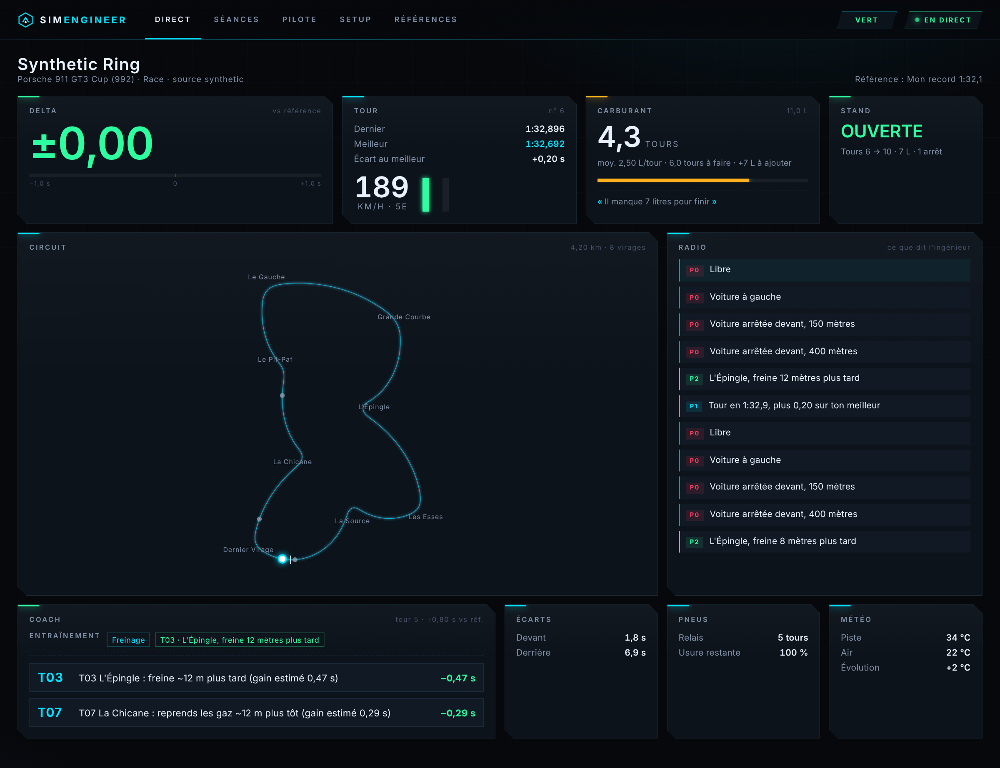
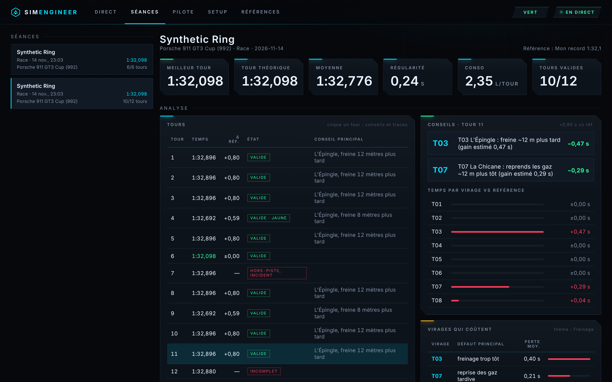
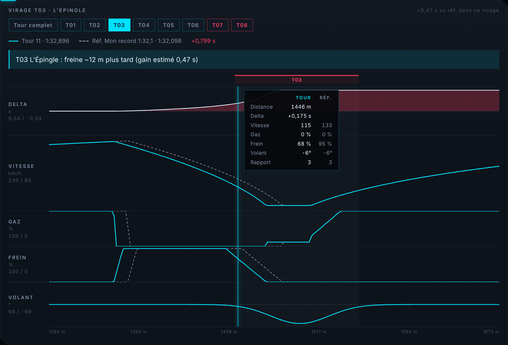
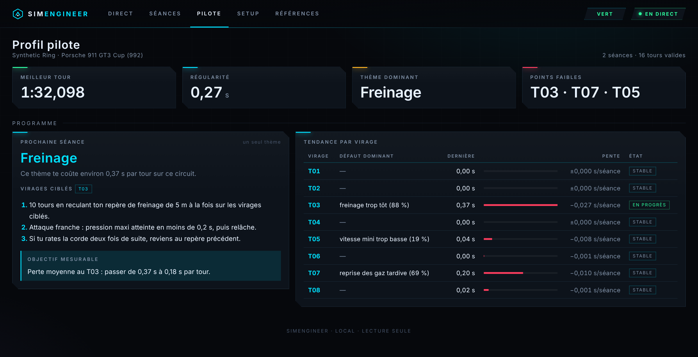
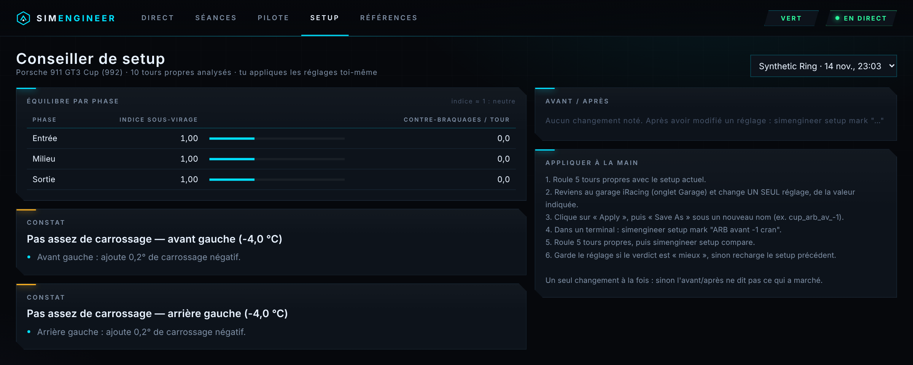
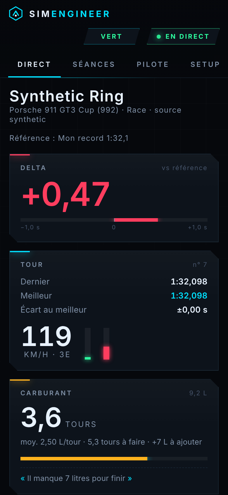
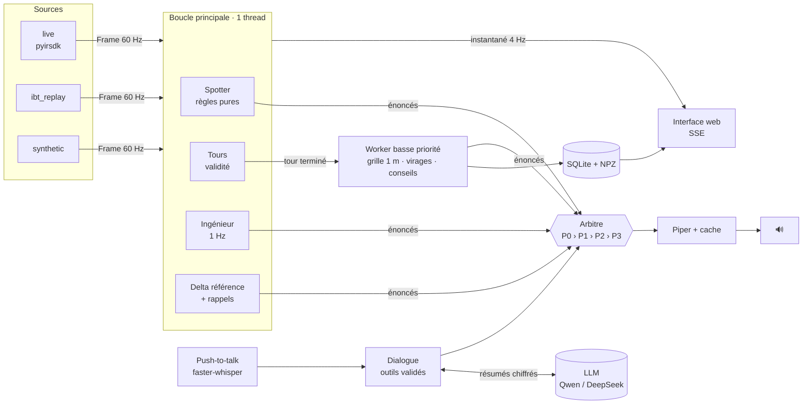

<div align="center">

# SimEngineer

**Ingénieur de course IA, local, pour iRacing.**
Spotter vocal · stratégie carburant et stands · coach par virage · dialogue push-to-talk · interface sombre en direct

[](https://github.com/valak74/SimEngineer/actions/workflows/ci.yml)




</div>

> **État du projet.** Tout est développé et testé avec des données **simulées** (source
> synthétique et rejeu `.ibt`). Rien n'a encore tourné avec iRacing lancé : les noms des
> variables du SDK, la voix et les appels LLM réels restent **à vérifier** sur le PC de jeu
> (liste dans [`docs/RUN_ON_PC.md`](docs/RUN_ON_PC.md), hypothèses dans
> [`docs/ASSUMPTIONS.md`](docs/ASSUMPTIONS.md)).

---

## Sommaire

- [Ce que fait SimEngineer](#ce-que-fait-simengineer)
- [Captures](#captures)
- [Principes](#principes)
- [Installation (Windows)](#installation-windows)
- [Démarrage rapide](#démarrage-rapide)
- [Utilisation au quotidien](#utilisation-au-quotidien)
- [Configuration](#configuration)
- [Voix et dialogue](#voix-et-dialogue)
- [Architecture](#architecture)
- [Performances](#performances)
- [Développement](#développement)
- [Limites connues](#limites-connues)
- [Documentation](#documentation)

---

## Ce que fait SimEngineer

| | Fonction | En bref |
|---|---|---|
| 🛡️ | **Spotter** | « Voiture à gauche / à droite », « Libre », voiture arrêtée ou hors-piste devant (avec la distance), accident, drapeaux, sortie de piste, **voiture plus rapide qui arrive derrière** (multiclasse). Règles pures, sans réseau, donnée → parole en moins de 200 ms. |
| ⛽ | **Ingénieur de course** | Consommation sur les tours propres, tours possibles, litres à ajouter, **fenêtre de stand** (course aux tours ou au temps, plusieurs arrêts, neutralisation longue), pneus, météo, écarts. |
| 🎯 | **Coach par virage** | Points de freinage, pression, montée en pression, trail-braking, vitesses d'entrée/mini/sortie, reprise des gaz, corrections de volant, comparés à une référence. Conseils chiffrés et classés par temps gagné : *« L'Épingle, freine 12 mètres plus tard »*. |
| 🏋️ | **Mode entraînement** | Un thème par séance (programme issu de ton profil). Rappel vocal **dans la ligne droite, avant** chaque virage ciblé, chiffré d'après ton tour précédent. |
| 📈 | **Traces superposées** | Ton tour contre la référence : delta cumulé, vitesse, gaz, frein, volant, rapport. Zoom par virage, réticule de lecture. |
| 🎙️ | **Dialogue push-to-talk** | Bouton de volant ou touche → transcription locale → réponse courte. Le LLM ne calcule rien : il lit des chiffres déjà calculés. Sans LLM, tout marche par gabarits. |
| ⛽🔧 | **Commandes de stand** | « Mets 20 litres » → *« 20 litres au prochain arrêt, je valide ? »* → « oui ». Désactivées par défaut. |
| 🧭 | **Références** | Import de tes tours `.ibt` ou CSV (provenance et droits obligatoires), delta en temps réel, sélection automatique même circuit / même voiture. |
| 👤 | **Profil et programme** | Tendances par virage sur plusieurs séances, thème dominant, exercices et objectif mesurable. Seuils du coach calibrés sur ta régularité. |
| 🔩 | **Conseiller de setup** | Sous/survirage par phase de virage, températures et pressions des pneus, pistes de réglage, verdict avant/après sur tours propres. Tu appliques les réglages toi-même. |
| 🖥️ | **Interface** | Page locale sombre et futuriste, dans le navigateur, sur un second écran, une tablette ou un téléphone. |

## Captures

<table>
<tr>
<td width="50%"></td>
<td width="50%"></td>
</tr>
<tr>
<td align="center"><b>Séances</b> : tours, conseils, temps par virage</td>
<td align="center"><b>Traces</b> : ton tour (trait plein) contre la référence (pointillés)</td>
</tr>
<tr>
<td></td>
<td></td>
</tr>
<tr>
<td align="center"><b>Pilote</b> : programme de la prochaine séance, tendances</td>
<td align="center"><b>Setup</b> : équilibre par phase, avant/après</td>
</tr>
</table>

<p align="center"><br><sub>Sur téléphone ou tablette (accès réseau local optionnel)</sub></p>

<sub>Captures réalisées sur un circuit synthétique de démonstration, virages nommés par un fichier de circuit.</sub>

## Principes

Ces règles sont non négociables (détail dans [`CLAUDE.md`](CLAUDE.md)) :

1. **Lecture seule du simulateur.** Aucune injection, aucun fichier iRacing modifié. Seules écritures possibles : les commandes de stand officielles du SDK, désactivées par défaut et confirmées à la voix.
2. **Le danger ne dépend jamais du réseau.** Spotter et alertes = règles pures, locales.
3. **Le LLM ne calcule jamais.** Carburant, deltas, distances, fenêtres : tout est calculé en code. Une réponse qui contient un chiffre absent des résultats d'outils est rejetée.
4. **Ne pas voler de ressources au sim.** Collecteur < 3 % d'un cœur et < 150 Mo, aucun GPU, analyses lourdes dans un processus à basse priorité.
5. **Local d'abord.** Télémétrie stockée chez toi (SQLite + NPZ). Seuls des résumés chiffrés partent vers le LLM, jamais de noms de pilotes ni de flux brut. Mode « tout local » complet.
6. **Aucun nom de variable iRacing inventé.** Tout passe par une constante unique `VARS`, validée au démarrage et vérifiable avec `dump-vars`.
7. **Références légales uniquement.** Seulement des fichiers que tu possèdes, avec provenance et droits déclarés.
8. **Aucune clé d'API dans le code ni dans git.**

## Installation (Windows)

Prérequis : **Windows 10/11**, **Python 3.12** (case *Add to PATH* cochée), git.

```powershell
git clone https://github.com/valak74/SimEngineer.git
cd SimEngineer
powershell -ExecutionPolicy Bypass -File scripts\install_windows.ps1
```

Le script crée `.venv`, installe `simengineer[live,llm,voice,perf]` et crée `simengineer.toml` (source `live`).

Ensuite :

1. **Voix** : télécharge dans `models\` une voix Piper française (`fr_FR-siwis-medium.onnx` + `.onnx.json`), et une anglaise si besoin. Les chemins sont dans `simengineer.toml`.
2. **Clés d'API** (facultatives, voir [Configuration](#configuration)).
3. **Démarrage automatique** avec Windows (attend iRacing sans consommer de CPU) :
   ```powershell
   powershell -ExecutionPolicy Bypass -File scripts\install_autostart.ps1
   ```
4. **Exécutable autonome** (facultatif) : `scripts\build_exe.ps1` → `dist\simengineer\simengineer.exe`.

> Dans la suite, `simengineer` = `.\.venv\Scripts\simengineer.exe` (ou active le venv).

## Démarrage rapide

**Sans iRacing**, pour tout voir tout de suite (course de démonstration accélérée ×6) :

```powershell
simengineer run --source synthetic --scenario race --speed 6 --null-voice --keep-ui
```

L'interface s'ouvre sur `http://127.0.0.1:8765/`. Les messages vocaux s'affichent dans le terminal.

**Avec iRacing** :

```powershell
simengineer dump-vars --source live   # une fois, en piste : vérifie les variables du SDK
simengineer say-test                  # vérifie la voix et la latence
simengineer run --source live         # attend iRacing, puis tout démarre
```

## Utilisation au quotidien

### Rouler

| Commande | Effet |
|---|---|
| `simengineer run --source live` | Spotter + ingénieur + coach + dialogue + interface. Se remet en attente après chaque séance. |
| `simengineer run --source live --training` | Ajoute les rappels vocaux avant les virages du programme. |
| `simengineer run … --no-ui` / `--null-voice` | Sans interface / sans audio (texte dans le terminal). |
| `simengineer ui` | Interface seule, pour consulter l'historique. |

### Analyser

| Commande | Effet |
|---|---|
| `simengineer analyze [--ibt fichier.ibt]` | Conseils par virage de la dernière séance (ou d'un fichier `.ibt`). |
| `simengineer report [--llm]` | Rapport Markdown dans `data\reports\`. Commentaire rédigé par le LLM en option. |
| `simengineer profile` | Profil pilote : tendances par virage, points forts et faibles. |
| `simengineer training` | Programme de la prochaine séance : un thème, des exercices, un objectif chiffré. |
| `simengineer sessions` | Liste des séances enregistrées. |

### Références

```powershell
simengineer ref import mon_record.ibt --source "mon meilleur tour" --rights "personnel"
simengineer ref import pro.csv --track "Spa-Francorchamps" --car "Porsche 911 GT3 Cup (992)" `
    --source "pack acheté le 12/03" --rights "licence personnelle"
simengineer ref list
```

La référence la plus rapide pour **le même circuit et la même voiture** est choisie automatiquement. Sans référence, c'est ton meilleur tour de la séance.

### Nommer les virages

```powershell
simengineer track export   # crée data\tracks\<circuit>.toml à partir de la détection
notepad data\tracks\spa_francorchamps.toml
simengineer track show
```

Renseigne `label = "La Source"`. Tu peux aussi corriger les bornes, supprimer un virage ou fusionner une chicane. Le fichier est utilisé partout : voix, conseils, carte, traces, setup.

### Setup

```powershell
simengineer setup diagnose              # constats + pistes de réglage
simengineer setup mark "ARB avant -1"   # après avoir changé UN réglage dans le garage
simengineer setup compare               # avant / après sur tours propres, avec verdict
```

## Configuration

Copie [`simengineer.example.toml`](simengineer.example.toml) en `simengineer.toml`. Pour des réglages personnels non versionnés, utilise `simengineer.local.toml`, ignoré par git. Toute valeur peut aussi être surchargée par variable d'environnement :

```
SIMENGINEER__SECTION__CLE=valeur      ex. SIMENGINEER__LLM__ENABLED=false
```

| Section | Réglages utiles |
|---|---|
| `[source]` | `kind` (`live`, `ibt_replay`, `synthetic`), `speed` (rejeu accéléré) |
| `[voice]` | voix Piper FR/EN, `output_device`, `input_device` (voir `simengineer devices`), push-to-talk `ptt_kind` = `keyboard` ou `joystick` + `ptt_key` / `ptt_button` |
| `[spotter]` | distances et délais des alertes, `faster_*` (voiture plus rapide derrière) |
| `[engineer]` | `fuel_margin_laps`, `pit_commands_enabled` (**false** par défaut), `pit_confirm` |
| `[coach]` | seuils, `training_mode`, `callout_lead_s` (avance des rappels, 3,5 s) |
| `[ui]` | `port` (8765), `open_browser`, `host = "0.0.0.0"` pour une tablette du réseau local |
| `[llm]` | `enabled`, `timeout_s`, `daily_budget_usd`, liste des fournisseurs |

### Clés d'API (facultatives)

| Variable | Fournisseur |
|---|---|
| `DASHSCOPE_API_KEY` | Qwen (Alibaba Cloud Model Studio, endpoint international) : principal |
| `DEEPSEEK_API_KEY` | DeepSeek : secours |

```powershell
setx DASHSCOPE_API_KEY "…"
setx DEEPSEEK_API_KEY  "…"
```

Tu peux aussi les mettre dans un fichier `.env` à la racine (ignoré par git). Sans clé, SimEngineer fonctionne entièrement en local par gabarits. Pour changer de fournisseur ou de modèle, modifie seulement le TOML (`base_url`, `model`, `api_key_env`), tout client compatible OpenAI convient.

## Voix et dialogue

**Une seule voix, quatre priorités.** Un arbitre unique décide qui parle :

| Priorité | Exemples | Règle |
|---|---|---|
| **P0** danger | voiture à gauche, arrêtée devant, drapeau jaune | coupe tout, ≤ 8 mots, < 200 ms |
| **P1** course | carburant, stand, temps au tour, voiture plus rapide | dans l'ordre, messages périmés supprimés |
| **P2** coaching | conseils, rappels d'entraînement | ligne droite uniquement, jamais au freinage ni en duel, ≤ 8 mots |
| **P3** conversation | réponses à tes questions | quand la radio est libre |

**Dialogue** : maintiens le bouton, pose ta question, relâche.

- *« Combien de carburant ? »* → *« Il manque 7 litres pour finir »*
- *« Je rentre quand ? »* → *« Fenêtre de stand : tours 6 à 10, 7 litres à ajouter »*
- *« Un conseil pour l'Épingle ? »* → *« L'Épingle, freine 12 mètres plus tard »*
- *« Mets 20 litres »* → *« 20 litres au prochain arrêt, je valide ? »* → *« Oui »* → *« Stand réglé : 20 litres »*

Côté LLM, chaque requête a un délai de 8 s et une nouvelle tentative. Si le fournisseur principal ne répond pas, SimEngineer bascule sur celui de secours, puis répond par gabarit. Un plafond de dépense quotidien s'applique. Le prompt système et les définitions d'outils restent identiques d'une requête à l'autre, ce qui favorise le cache de prompt.

## Architecture



| Module | Rôle |
|---|---|
| `core` | configuration, journalisation, `VARS`, types, bus d'événements |
| `sources` | `live`, `ibt_replay` (lecteur `.ibt` intégré), `synthetic` (scénarios) |
| `telemetry` | découpage en tours, validité, grille de 1 m, mesure de précision de position |
| `spotter` | règles pures + hystérésis + délais, journal JSONL avec latence |
| `engineer` | carburant, fenêtre de stand, pneus, météo, écarts, commandes de stand |
| `coach` | virages, métriques, conseils, rappels, profil, programme, calibration, rapport |
| `reference` | import `.ibt`/CSV, delta temps réel, sélection automatique |
| `setup` | diagnostic, avant/après, guide d'application |
| `voice` | gabarits FR/EN, arbitre, TTS Piper + cache, STT, push-to-talk |
| `llm` | client multi-fournisseurs, outils validés par pydantic, budget, rapport |
| `ui` | serveur local, direct (SSE) et historique, HTML/CSS/JS sans dépendance |
| `store` | SQLite + fichiers NPZ |

## Performances

Mesures reproductibles avec `simengineer perf` (détail dans [`docs/PERF.md`](docs/PERF.md)) :

| Mesure (simulé, 20 voitures) | Valeur | Budget |
|---|---|---|
| CPU du collecteur | 1,5 à 1,7 % d'un cœur | < 3 % |
| Mémoire du collecteur | 80 à 87 Mo | < 150 Mo |
| Temps par image | 0,1 ms en moyenne | 16,7 ms |
| Avec l'interface et un navigateur connecté | 1,5 % / 87 Mo | idem |

À confirmer en conditions réelles : `simengineer perf --source live --with-ui`.

## Développement

```bash
pip install -e ".[dev]"
pytest -q && ruff check . && ruff format --check . && mypy src
```

- **Tout est testable sans iRacing** : scénarios synthétiques `race`, `clean`, `stopped_car`, `overtake`, `accident`, `multiclass`, `perf`, avec défauts de pilotage injectables. Le lecteur `.ibt` est vérifié en aller-retour.
- Le **LLM** est testé avec un faux client : chiffres repris exactement des outils, délai dépassé, appel d'outil mal formé, bascule de fournisseur, mode local.
- La **CI GitHub** tourne sous **Windows et Ubuntu** : lint, typage strict, tests et démo de bout en bout.
- Méthode et règles du projet : [`CLAUDE.md`](CLAUDE.md). Choix tranchés : [`docs/DECISIONS.md`](docs/DECISIONS.md).

## Limites connues

- iRacing ne fournit ni la télémétrie complète des autres pilotes ni leur position latérale. Une voiture arrêtée devant est annoncée **avec la distance, sans le côté**. Le côté ne vient que des voitures adjacentes (`CarLeftRight`).
- L'alerte « voiture plus rapide » se fonde sur l'écart en temps, sans connaître la classe de la voiture.
- La comparaison aux pilotes rapides passe par des **tours de référence importés**, jamais par un flux en direct.
- La précision de trajectoire dépend du SDK : elle est mesurable (`simengineer measure-position`), pas garantie.
- En course au temps, le nombre de tours restants est une estimation : l'arrivée dépend du leader.
- Les setups iRacing sont chiffrés. SimEngineer propose les réglages, et c'est toi qui les appliques.
- L'interface est en français. Les messages vocaux existent en français et en anglais.

## Documentation

| Document | Contenu |
|---|---|
| [`docs/RUN_ON_PC.md`](docs/RUN_ON_PC.md) | **Vérifications à faire sur le PC de jeu** (liste numérotée) |
| [`docs/ASSUMPTIONS.md`](docs/ASSUMPTIONS.md) | Hypothèses (variables SDK, fournisseurs, voix) et leur statut |
| [`docs/SPEC.md`](docs/SPEC.md) | Spécification et architecture |
| [`docs/PERF.md`](docs/PERF.md) | Mesures CPU/RAM |
| [`docs/DECISIONS.md`](docs/DECISIONS.md) | Choix tranchés |
| [`docs/PROGRESS.md`](docs/PROGRESS.md) | Avancement par phase |
| [`docs/ROADMAP.md`](docs/ROADMAP.md) | Phases du projet |

---

<sub>SimEngineer n'est ni affilié à iRacing.com Motorsport Simulations ni approuvé par celui-ci. Licence : à définir.</sub>
